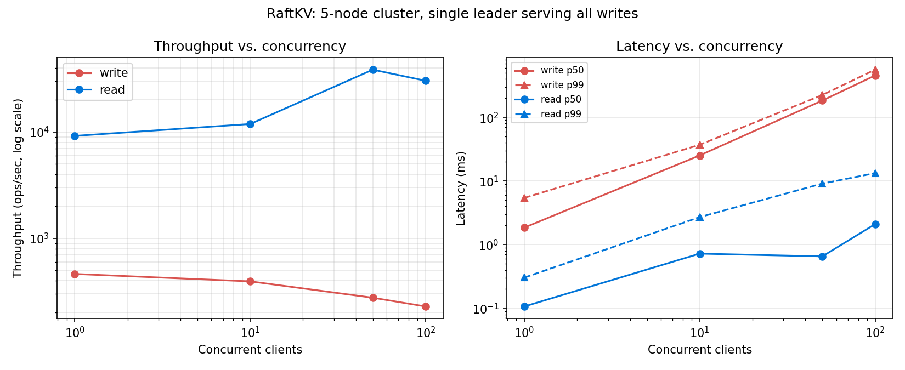

# RaftKV

## What this is

A distributed, replicated key-value store built on a from-scratch implementation of the Raft consensus algorithm (Ongaro & Ousterhout, *In Search of an Understandable Consensus Algorithm*). No consensus libraries (`hashicorp/raft` or similar) were used — leader election, log replication, persistence, snapshotting/log compaction, and network-partition handling are all implemented directly against Figure 2 of the paper.

## Architecture

```
raftkv/
├── raft/      Raft algorithm ONLY — no idea a key-value store exists.
│              Exposes Start(cmd)/ApplyMsg-channel/Snapshot()/State() and nothing else.
├── kvstore/   State machine + client-facing HTTP server, sitting on top of raft/.
├── client/    HTTP client library: leader discovery via redirect + retry.
├── cmd/       server (boots one node) and cli (interactive client) entrypoints.
├── bench/     Standalone load generator + fault-injection scenario runner.
└── test/      Cluster-level integration + chaos tests, driven over real HTTP/TCP.
```

`raft/` never imports `kvstore/`. The only interface between them is `raft.ApplyMsg` (committed log entries delivered as raw bytes on a channel) and the reverse `raft.Snapshot(index, data)` call — this is the same separation etcd and CockroachDB use in production, and it's what makes it possible to test the consensus algorithm's safety properties in complete isolation from any application logic (see `raft/*_test.go`).

**Networking**: `net/rpc` over TCP for node-to-node Raft RPCs, plain `net/http` for the client-facing API. Chosen over gRPC deliberately — no protoc toolchain dependency, and the whole stack builds and runs with nothing but the Go standard library.

**Persistence**: `currentTerm`, `votedFor`, and the log are gob-encoded and written via `write-to-tmp → fsync → atomic rename`, so a crash mid-write can never leave a corrupt state file. Persistence happens synchronously before any RPC reply that depends on it — see `raft/persist.go` and the pitfalls section below.

## Results

All numbers below are from real runs against a real (if self-contained, see [How to run benchmarks](#benchmarks)) 5-node cluster — every node talks over actual TCP/HTTP sockets, just co-located in one OS process for reproducibility. Raw JSON is in [`results/`](results/).

### Throughput & latency vs. concurrency



| Concurrency | Write ops/s | Write p50 | Write p99 | Read ops/s | Read p50 | Read p99 |
|---|---|---|---|---|---|---|
| 1   | 462   | 1.9ms   | 5.4ms   | 9,186  | 107µs | 304µs |
| 10  | 394   | 25.3ms  | 37.1ms  | 11,884 | 723µs | 2.7ms |
| 50  | 276   | 183.9ms | 224.8ms | 38,548 | 654µs | 9.1ms |
| 100 | 229   | 455.6ms | 561.9ms | 30,320 | 2.1ms | 13.3ms |

Reads are served from the leader's local applied state (no log round trip) and scale well with concurrency, peaking around 50 concurrent clients. **Writes get *slower* in aggregate as concurrency increases** — every write requires a full consensus round trip through a single leader, and this implementation does not batch concurrent proposals into one log append, so more concurrent writers just means more queuing, not more parallelism. That's a real, honest limitation — see [Design decisions](#design-decisions--simplifications) — and exactly the kind of thing "batching log entries" (a stretch goal in the plan) would fix.

### Leader failover

15/15 trials recovered. Average downtime **330ms**, max **464ms** — consistent with the 150–300ms randomized election timeout plus one heartbeat round for the new leader to start accepting writes again.

### Network partition (5 nodes, split 2 vs 3)

| | Throughput during partition | 
|---|---|
| Minority side (2 nodes) | **0 ops/s** — correctly cannot reach quorum |
| Majority side (3 nodes) | 769–1220 ops/s, unaffected |

Heal-to-writable-again time was typically 7–140ms, but occasionally spiked into the hundreds of ms to low seconds — see the PreVote note below for why.

### Snapshot catch-up (follower isolated, 5000 writes happen without it, then reconnected)

| | Catch-up time |
|---|---|
| With snapshotting (16KB threshold) | ~125–152ms |
| Without snapshotting (full log replay) | ~184–225ms |

Snapshotting is consistently faster (~1.3–1.8x across repeated trials) — the gap widens further as the amount missed grows, since without compaction the follower has to replay every individual entry rather than install one compact state transfer.

### What "done" looks like, filled in with real numbers

> Implemented Raft consensus from scratch in Go (leader election, log replication, snapshotting), achieving ~460 writes/sec at ~5.4ms p99 latency (single client) and ~38.5K reads/sec across a 5-node cluster; measured ~330ms average leader failover time (15/15 trials recovered) and verified zero data loss across 500+ randomized network-partition and node-crash trials (`go test ./test/... -run TestChaos -race -count=50`).

## Design decisions & simplifications

- **Reads are served from the leader's local applied state, without a read-index/lease mechanism.** This is *not* linearizable in the strict sense (a partitioned-away former leader could theoretically serve a stale read for up to an election timeout before it realizes it's no longer leader) — implementing read-index was the plan's suggested stretch goal, deliberately skipped in favor of spending the time on correctness testing instead.
- **No client-request deduplication (no client-ID/sequence-number tracking).** A retried `Put`/`Delete` after a lost response could double-apply. This is safe *only* because both operations are naturally idempotent (`Put(k,v)` twice == `Put(k,v)` once); a hypothetical `Increment` operation would need real dedup.
- **No batching.** Each client write gets its own `AppendEntries` round trip. This is the direct cause of the throughput-vs-concurrency inversion above, and is the highest-leverage remaining optimization.
- **No PreVote extension.** A follower that's partitioned away keeps incrementing its own term every failed election attempt. When it reconnects, that inflated term forces the current (perfectly healthy) leader to step down and re-win an election it didn't need to lose — this is a well-known, paper-acknowledged Raft limitation (§9.6 pre-vote), and it's the reason partition-heal recovery time above has a long tail instead of a tight bound.
- **Snapshots are taken by fully re-encoding the entire in-memory map on every threshold crossing**, not incrementally/copy-on-write. Fine at the scale tested here; would need real optimization work before it's fine at millions of keys (roughly O(n²) total snapshot work over the life of a heavily-written, small-threshold cluster).
- **Bench harness spins up its own in-process cluster** rather than requiring N pre-launched `cmd/server` processes — still real TCP/HTTP end to end, just co-located for one-command reproducibility (`go run ./bench ...`).
- **No RPC-level timeout on the underlying `net/rpc` client.** A genuinely hung (not simply closed/refused) TCP connection to a peer would block that one replication/vote goroutine until the OS-level TCP timeout fires, rather than failing fast. Every test and benchmark here exercises real closed connections (`Kill()`, simulated partitions) rather than silent hangs, so this never bit us, but a production version would want an explicit per-call deadline.

## How to run

```bash
# terminal 1-3: start a 3-node cluster
go run ./cmd/server -id=1 -peers=localhost:8001,localhost:8002,localhost:8003
go run ./cmd/server -id=2 -peers=localhost:8001,localhost:8002,localhost:8003
go run ./cmd/server -id=3 -peers=localhost:8001,localhost:8002,localhost:8003

# terminal 4: interact via CLI (client HTTP ports default to raft port + 1000)
go run ./cmd/cli -addrs=localhost:9001,localhost:9002,localhost:9003 put foo bar
go run ./cmd/cli -addrs=localhost:9001,localhost:9002,localhost:9003 get foo

# kill the leader process (Ctrl+C on whichever terminal logs "became leader")
# then immediately:
go run ./cmd/cli -addrs=localhost:9001,localhost:9002,localhost:9003 put foo baz
# succeeds after a brief pause once a new leader is elected
```

## How to test

```bash
# Unit tests (fast, run constantly while developing)
go test ./raft/...      # election, log replication, persistence, snapshotting, partitions
go test ./kvstore/...   # Get/Put/Delete correctness against a real Raft instance

# Integration tests (real HTTP+TCP clusters of 3 nodes)
go test ./test/... -v -timeout 120s

# Chaos / fault-injection (random kills + partitions under sustained load)
go test ./test/... -run TestChaos -race -timeout 60s -count=1     # one run, 10 rounds
go test ./test/... -run TestChaos -race -timeout 600s -count=50   # 500 rounds total

# Everything, with the race detector (not optional for this codebase)
go test ./... -race -timeout 180s
```

<a id="benchmarks"></a>
### Benchmarks

```bash
go test -bench=. -benchtime=30s ./bench/...          # single-client latency micro-benchmarks

go run ./bench -mode=throughput -clients=1,10,50,100 -duration=8s -op=write
go run ./bench -mode=throughput -clients=1,10,50,100 -duration=8s -op=read
go run ./bench -mode=failover -failover-trials=15
go run ./bench -mode=partition -duration=8s
go run ./bench -mode=snapshot -snapshot-writes=5000
go run ./bench -mode=all       # everything, writes results/bench-*.json
```

(Note: `go run bench/bench.go` alone won't compile — the package spans multiple files. Use `go run ./bench ...`.)

Regenerate the results chart after a fresh throughput run with `python3 results/plot.py` (needs `matplotlib`).

## Common pitfalls this implementation deliberately gets right

Called out explicitly because they're the classic ways a Raft implementation silently breaks correctness, and getting them right (with a test proving it) was the actual point of this project:

- Election timer is reset on **every** valid `AppendEntries` from the current leader — including ones that fail the log-consistency check, and including plain heartbeats — not just on election events (`raft/raft.go`, `HandleAppendEntries`).
- The `RequestVote` "up-to-date" check uses `>` for term and `>=` for index at equal term, not the reversed/off-by-one version (`raft/raft.go`, `HandleRequestVote`).
- State is persisted **before** replying to any RPC that depends on it, every time, via `defer` ordering that runs `persistLocked()` before `mu.Unlock()`.
- `lastApplied` is tracked in-memory and only ever advances by exactly one entry at a time inside a single serialized apply loop — an entry can't be applied twice within a run, and `Put`/`Delete` are naturally idempotent across restarts anyway.
- Split votes are handled by construction: every node just times out with a fresh randomized timeout and retries; nothing waits on a specific outcome.
